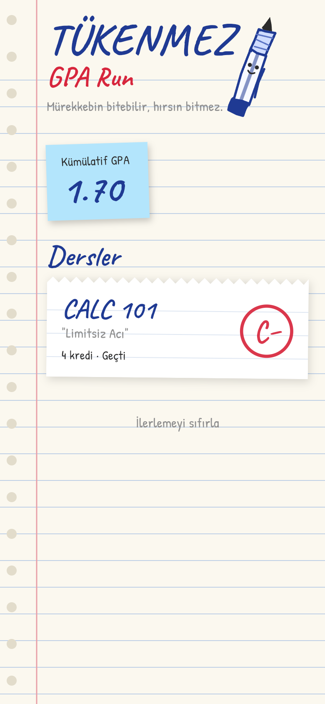
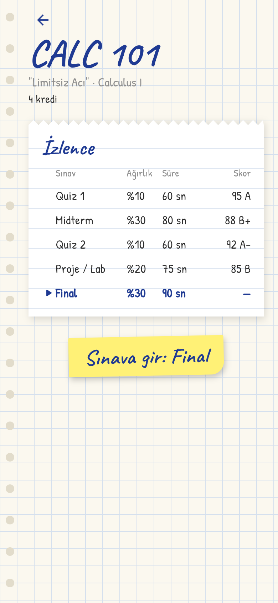
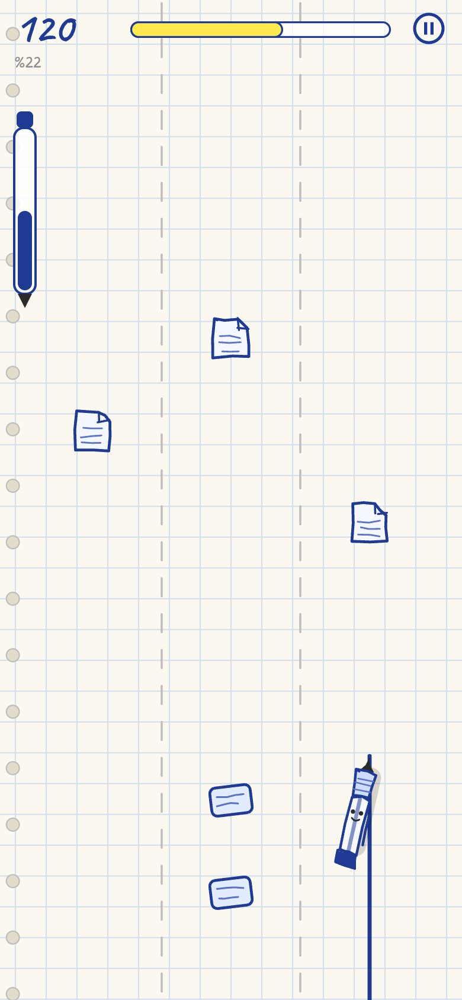
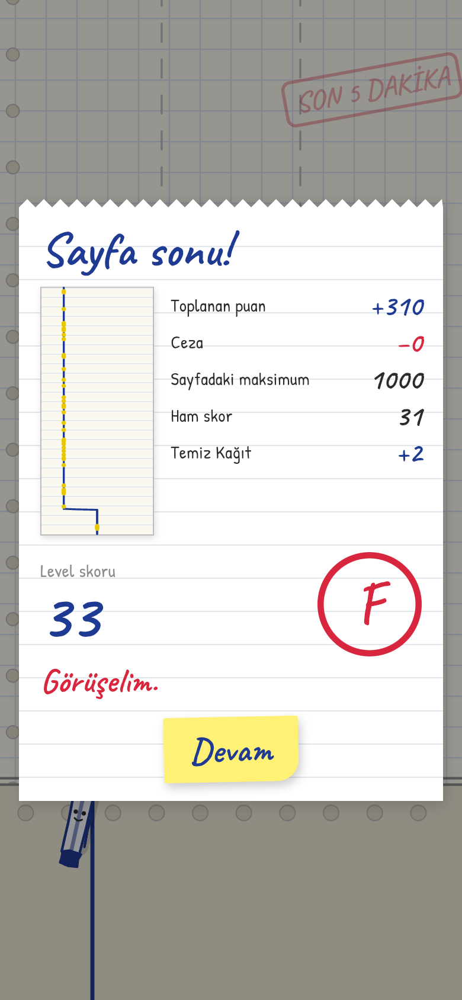
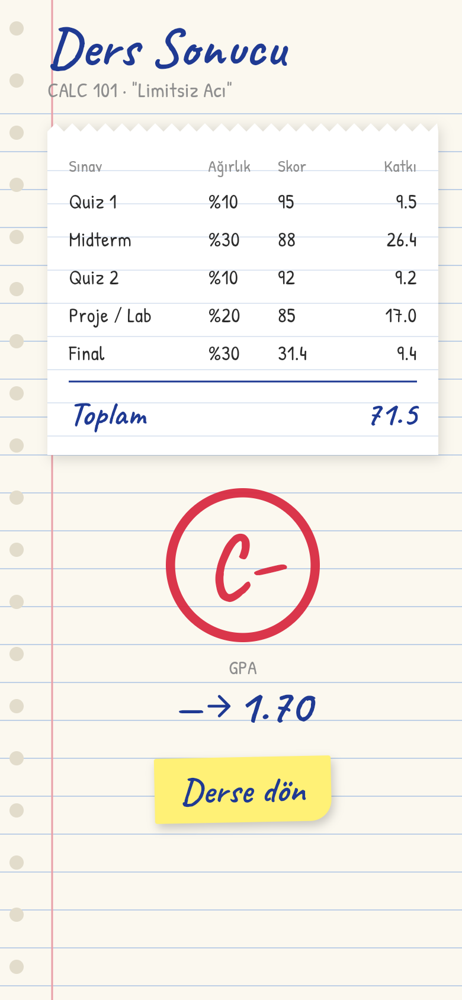

# TÜKENMEZ: GPA Run

> *"Mürekkebin bitebilir, hırsın bitmez."*

Bir tükenmez kalem (Tüki) olarak defter sayfasında 3 şeritli koşu. Her level bir sınav, 5 sınav bir ders,
her ders sonunda karneye bir harf notu ve 4.0 skalasında GPA. Flutter + Flame.

- Tasarım dokümanı: [`GAME_PROPOSAL.md`](GAME_PROPOSAL.md)
- Mimari ve JSON şemaları: [`docs/ARCHITECTURE.md`](docs/ARCHITECTURE.md)
- Kararlar ve varsayımlar: [`docs/DECISIONS.md`](docs/DECISIONS.md)

| Menü | İzlence | Oyun | Level sonu | Ders sonu |
|---|---|---|---|---|
|  |  |  |  |  |

## Çalıştırma

```bash
flutter pub get
flutter run            # bağlı cihaz veya emülatör/simülatör
flutter run -d chrome  # hızlı deneme (fare sürüklemesi = swipe)
```

## Kontroller

| Swipe | Aksiyon |
|---|---|
| ← → | Satır atla (şerit değiştir) |
| ↑ | Kalem kaldır (zıpla, yer engellerini aşar) |
| ↓ | Yatık yazı (eğil, hava engellerinin altından geçer). Havadayken hızla iner. |

## Test

```bash
flutter analyze
flutter test           # domain + data + flame_test + widget testleri
```

## İçerik ekleme

Yeni bir ders eklemek için kod değil veri eklenir: `assets/levels/<ders>/` altına `course.json`, 5 level
JSON'u ve isteğe bağlı bir `patterns.json` koy, ardından `assets/levels/courses.json`'a ekle ve
`pubspec.yaml`'daki `assets:` listesine klasörü yaz. Yükleme sırasında veri doğrulanır ve hatalar
satır satır raporlanır. Oyun sabitleri `assets/config/` altındadır.
