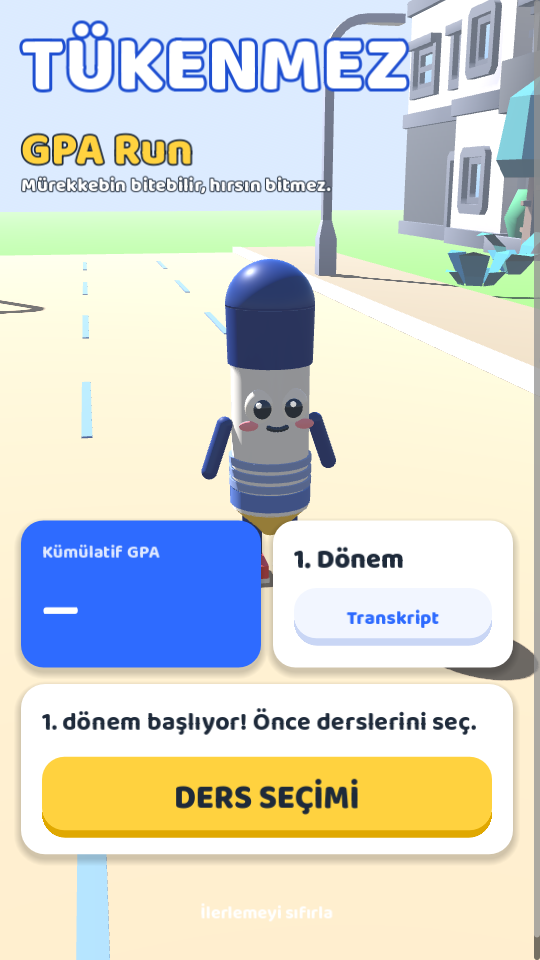
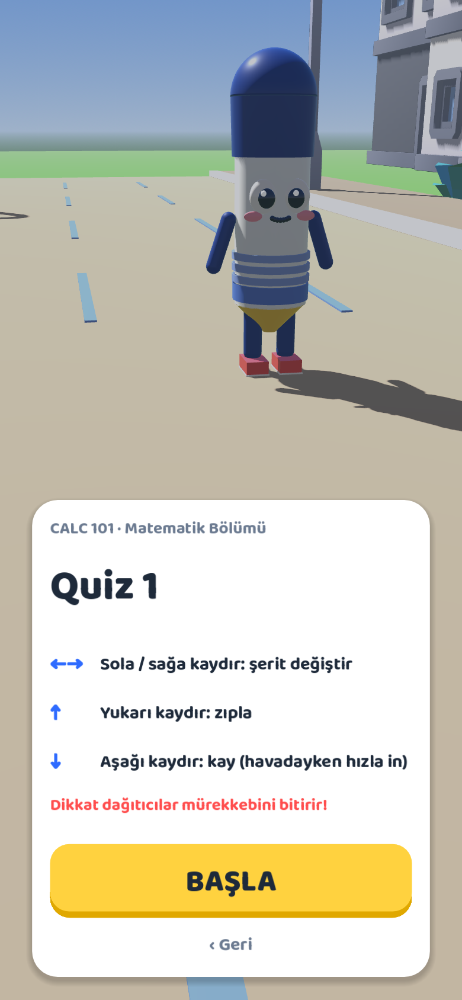
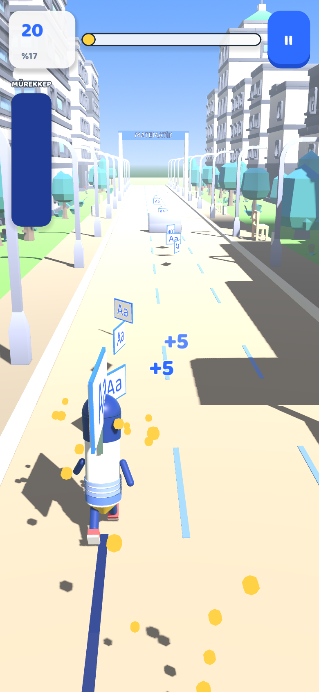
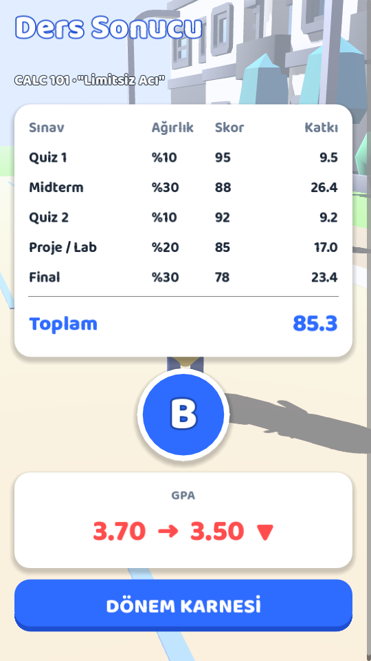
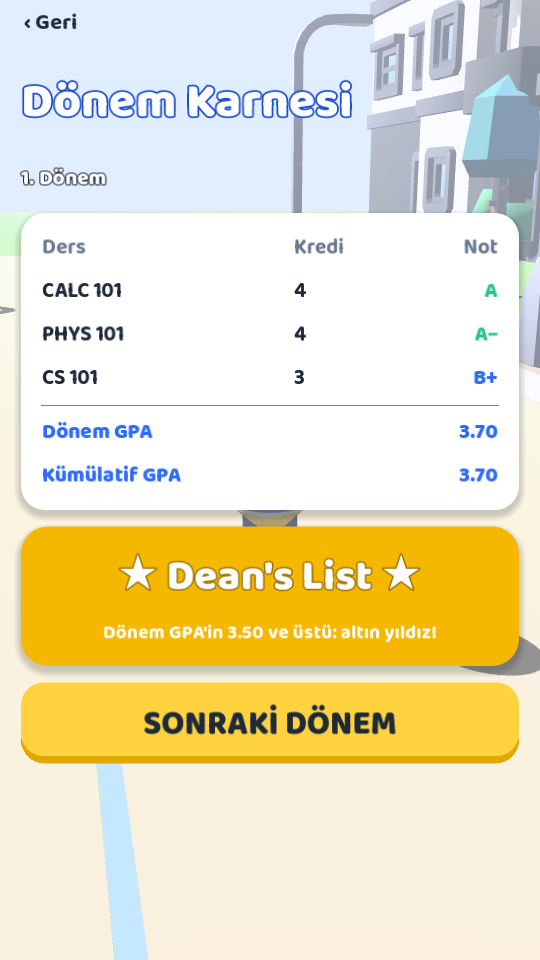
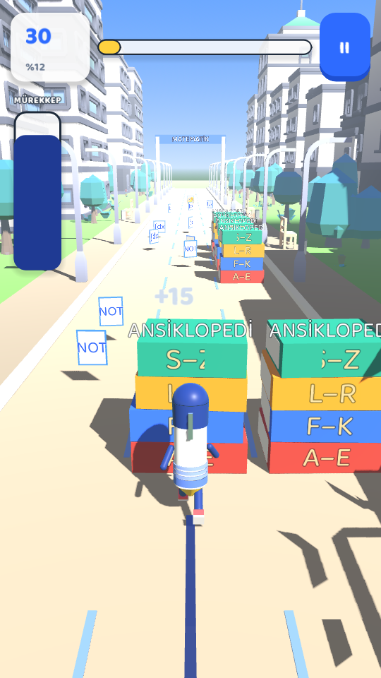
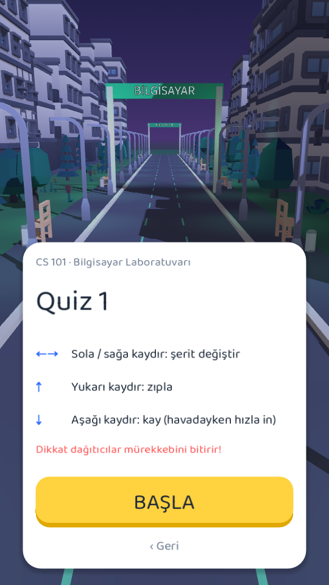
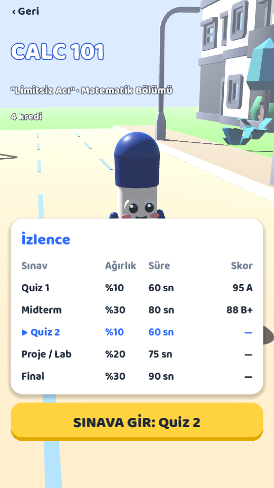
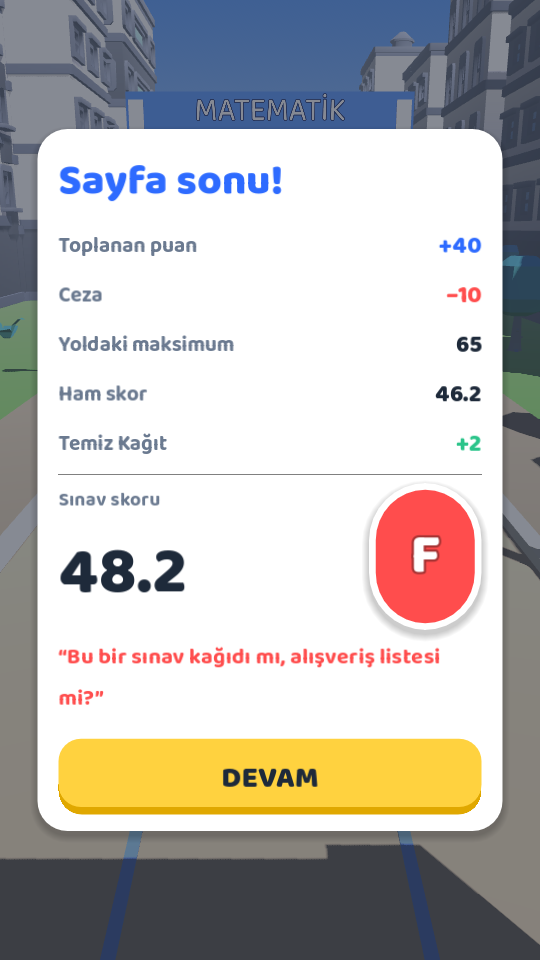
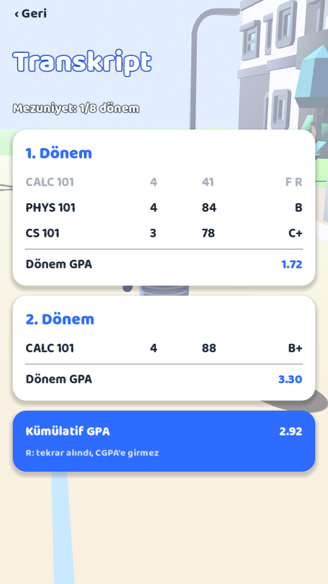

# TÜKENMEZ: GPA Run

> *"Mürekkebin bitebilir, hırsın bitmez."*

Kampüste koşan 3D bir tükenmez kalem: **Tüki**. Her koşu bir sınav, 5 sınav bir ders, her ders sonunda
karneye harf notu ve 4.0 skalasında GPA. Her dönem ders seçilir, dönem sonunda karne gelir
(Dean's List / Probation), F alınan ders tekrar alınır.

**Güncel sürüm: `godot/` (Godot 4.7.2, 3D).** Kökteki Flutter projesi (`lib/`, `test/`) 2D ilk sürümdür ve
referans olarak duruyor.

| Menü | Sınav başı | Koşu | Ders sonucu | Karne |
|---|---|---|---|---|
|  |  |  |  |  |

| Engeller | CS 101 gece | İzlence | Sınav sonu | Transkript |
|---|---|---|---|---|
|  |  |  |  |  |

- Tasarım dokümanı: [`GAME_PROPOSAL.md`](GAME_PROPOSAL.md)
- Kararlar: [`docs/DECISIONS.md`](docs/DECISIONS.md) · Mimari: [`docs/ARCHITECTURE.md`](docs/ARCHITECTURE.md)
- Kullanıcı geri bildirimi: [`docs/FEEDBACK.md`](docs/FEEDBACK.md)

## Çalıştırma (3D)

1. [Godot 4.7.2](https://godotengine.org/download) indir.
2. `godot/project.godot` dosyasını aç, **F5** ile çalıştır. Bilgisayarda klavye: ← → şerit, ↑ zıpla, ↓ kay.

```bash
# Testler (headless, gerçek fizikle)
godot --headless --fixed-fps 60 --path godot -s res://tests/run_tests.gd

# Android APK / Web
godot --headless --path godot --export-release "Android" ../build_godot/android/tukenmez.apk
godot --headless --path godot --export-release "Web" ../build_godot/web/index.html
```

Android release imzası için `GODOT_ANDROID_KEYSTORE_RELEASE_PATH/USER/PASSWORD` ortam değişkenleri kullanılır
(anahtar repoda tutulmaz).

## Kontroller

| Swipe | Aksiyon |
|---|---|
| ← → | Şerit değiştir |
| ↑ | Zıpla (bariyer ve konilerin üstünden) |
| ↓ | Kay (afişlerin altından); havadayken hızla in |

## İçerik ekleme

Yeni ders = veri: `godot/data/levels/<ders>/` altına `course.json`, 5 level JSON'u ve `patterns.json`;
`courses.json` ve `curriculum.json`'a ekle; `world3d.json → themes` altına dersin kampüs temasını yaz.
Yükleme sırasında veri doğrulanır.
